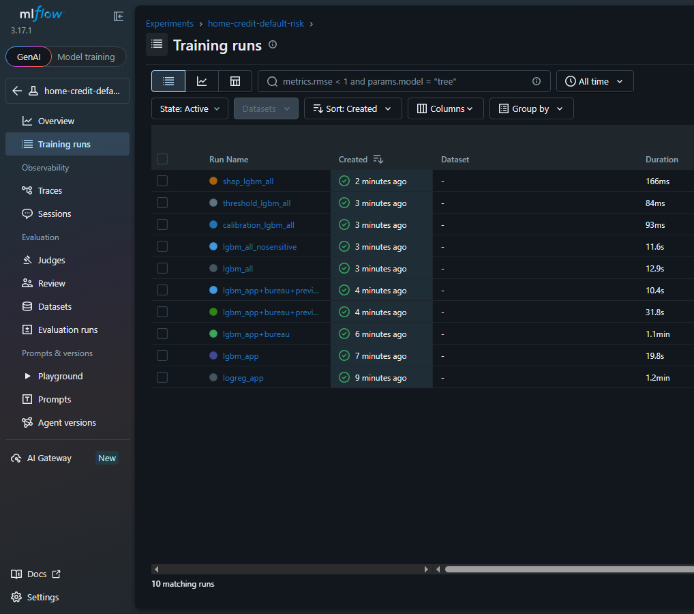
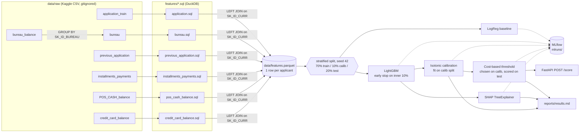

# Credit Risk Scoring with DuckDB and LightGBM (Home Credit Default Risk)

A loan-default model built on messy relational data: DuckDB SQL turns 7 Kaggle tables into one feature row per applicant, LightGBM scores them, isotonic regression calibrates the probabilities, SHAP explains them, and an explicit cost matrix picks the approve/reject threshold. Every run is tracked in MLflow.

 

> **Status (v1.0.0).** The code is complete. 31 tests pass and `ruff` is clean. The whole pipeline (features, 7 model runs, calibration, threshold, SHAP, report, API) has run end to end on this laptop, but **only on generated data with the real column names**. It has **not yet been run on the real Kaggle data**, because no Kaggle API token was set up on this machine when it was built, and the competition rules have to be accepted on kaggle.com by the account owner. For that reason this README shows **no model-quality numbers**. To produce them, see [Reproduce the real results](#reproduce-the-real-results): one download command, then one run command, after which the [Results](#results) block below is filled from `results/*.json`.

## Overview

**Problem.** Home Credit lends to people with little or no credit history. To predict whether an applicant will default (`TARGET = 1`), you need their application and also their history: Credit Bureau loans, earlier Home Credit applications, instalment payments, POS/cash loans and credit cards. That history is spread over 6 secondary tables with tens of millions of rows and one-to-many keys.

**What this repo does.**

1. **Feature store in SQL.** There is one DuckDB SQL file per table, and each aggregates to `SK_ID_CURR`: counts, sums/means/max of amounts, ratios, days-past-due rates, 12-month recency windows and the share of refused applications. `pipeline.py` LEFT JOINs everything onto the application table and writes `data/features.parquet`.
2. **Leakage guard rails as tests.** Each table gives exactly one row per applicant, and the output row count equals the application row count. No `TARGET` appears in any secondary aggregate. Future-dated (`DAYS_* > 0`) values never influence a feature. The train/calibration/test IDs are disjoint, the `DAYS_EMPLOYED = 365243` sentinel is handled, and the Parquet output is bit-for-bit deterministic.
3. **Models.** A Logistic Regression baseline on application-only features, and LightGBM with early stopping. A cumulative **table ablation** measures what each table adds.
4. **Calibration.** Isotonic regression is fitted on a held-out 10% calibration split. The report gives the Brier score, ECE and a reliability diagram before and after.
5. **Explainability.** SHAP TreeExplainer gives a global beeswarm and local waterfalls for approved and rejected applicants.
6. **Decision.** The threshold is chosen on calibrated probabilities to minimise `LGD x AMT_CREDIT` (missed default) plus `0.10 x AMT_CREDIT` (lost margin on a rejected good client). Its realised cost is compared with a 0.5 cut-off and with approving everyone, and the choice is re-run for LGD 0.30 / 0.45 / 0.60.
7. **Tracking and serving.** Every run logs params, metrics, the feature list and the model to MLflow. An optional FastAPI `POST /score` returns probability, decision and the top-5 SHAP reasons.

## Demo

The pipeline below ran on this laptop, on **generated test data** (`credit/synthetic.py`, 30,000 fake applicants that use the real schema). The output shows what the tool produces. **These are not Home Credit results**, and the plots say nothing about real credit risk.

```text
$ python -m credit.synthetic --n 30000 --seed 1 --out data/_dev/syn30k
$ python -m credit --config <demo config> all --check-determinism --no-readme
[features] done in 19.5s
[features_rebuild_for_determinism] done in 18.4s
determinism: identical parquet hash on rebuild = True
  application                 33 features     30000 rows     0.3s
  bureau                      32 features     29962 rows     1.0s
  previous_application        27 features     28912 rows     0.3s
  installments_payments       19 features     24880 rows     0.6s
  pos_cash_balance            14 features     20476 rows     0.2s
  credit_card_balance         17 features     12879 rows     0.1s
[train_logreg_app] done in 93.8s
[ablate] done in 260.1s
[train_lgbm_all_nosensitive] done in 23.2s
[calibrate] done in 0.8s
[threshold] done in 0.9s
[explain] done in 15.7s
wrote .../reports/results.md
```

The full console log and every output file from that demo run are in [`docs/synthetic_demo/`](docs/synthetic_demo/), and the generated report is [`docs/synthetic_demo/results.md`](docs/synthetic_demo/results.md). The real data has 120 application columns, while the generator makes only 25, so on Kaggle data the application table gives about 128 features.

| SHAP waterfall (synthetic demo) | Cost sweep (synthetic demo) |
|---|---|
|  |  |

The MLflow UI after that demo run (`mlflow ui --backend-store-uri sqlite:///mlruns/mlflow.db`, screenshot taken with headless Chrome on this laptop). Each model, calibration, threshold and SHAP step is one run with its params, metrics and artefacts:



## Architecture



## Tech stack

| Area | Tools |
|---|---|
| Feature engineering | DuckDB 1.5 (SQL over CSV, writes Parquet), PyArrow |
| Models | scikit-learn 1.9 (LogisticRegression, IsotonicRegression), LightGBM 4.7 |
| Explainability | SHAP 0.49 (TreeExplainer) |
| Tracking | MLflow 3.17 (local sqlite backend + local artefact folder) |
| Serving (optional) | FastAPI + Uvicorn |
| Quality | pytest (31 tests), ruff, GitHub Actions |
| Language | Python 3.12 |

## Project structure

```text
credit-risk-duckdb-lightgbm/
├── config.yaml                 # paths, split, hyper-parameters, cost matrix
├── features/                   # one DuckDB SQL file per table, all GROUP BY SK_ID_CURR
│   ├── application.sql
│   ├── bureau.sql              # bureau_balance -> SK_ID_BUREAU -> SK_ID_CURR
│   ├── previous_application.sql
│   ├── installments_payments.sql
│   ├── pos_cash_balance.sql
│   └── credit_card_balance.sql
├── credit/
│   ├── __main__.py             # CLI: python -m credit ...
│   ├── config.py
│   ├── pipeline.py             # runs the SQL, joins, writes Parquet, splits, determinism check
│   ├── train.py                # LogReg + LightGBM + ablation, MLflow logging
│   ├── calibrate.py            # isotonic, Brier, ECE, reliability diagram
│   ├── threshold.py            # cost matrix sweep + LGD sensitivity
│   ├── explain.py              # SHAP beeswarm + waterfalls
│   ├── report.py               # reports/results.md + README results block
│   ├── api.py                  # optional FastAPI POST /score
│   └── synthetic.py            # generated Home-Credit-shaped data for tests/CI only
├── scripts/download.sh         # Kaggle CLI download into data/raw/
├── scripts/compare_agg_threads.py  # rebuilds the features N times and compares hashes (determinism check)
├── tests/                      # leakage, data, determinism, cost, end-to-end, API tests
│   └── fixtures/               # small generated CSVs (300 applicants, real column names)
├── docs/synthetic_demo/        # output of a full run on generated data (format demo only)
├── docs/mlflow_runs_synthetic_demo.png
├── results/                    # JSON/CSV/log files behind every reported number
│   └── synthetic_scale_check/  # 300k generated applicants: timing + determinism only
├── reports/                    # plots + results.md (written by `python -m credit report`)
├── data/                       # gitignored: raw CSV, features.parquet, splits.parquet, predictions
├── requirements.txt            # pinned
├── CHANGELOG.md
├── github_meta.json            # repo description, topics and release notes for publishing
└── .github/workflows/ci.yml    # ruff + pytest on fixture data
```

## Setup

```bash
git clone <this repo> && cd credit-risk-duckdb-lightgbm
python -m venv .venv && source .venv/bin/activate   # Windows: .venv\Scripts\activate
pip install -r requirements.txt
```

To get the data, accept the competition rules at <https://www.kaggle.com/competitions/home-credit-default-risk/rules>, put a Kaggle API token in `~/.kaggle/`, and then run:

```bash
bash scripts/download.sh          # the competition CSVs (about 2.7 GB unzipped) into data/raw/ (gitignored)
```

## Usage

```bash
python -m credit features --check-determinism    # SQL -> data/features.parquet + data/splits.parquet
python -m credit train --model logreg --tables app
python -m credit train --model lgbm --tables all
python -m credit train --model lgbm --tables all --drop-sensitive   # fairness check
python -m credit ablate                           # app, +bureau, +previous_application, +installments, +POS/credit card
python -m credit calibrate
python -m credit threshold
python -m credit explain
python -m credit report                           # reports/results.md + the Results block of this README

python -m credit all --check-determinism          # everything above, in order

mlflow ui --backend-store-uri sqlite:///mlruns/mlflow.db   # browse every run
uvicorn credit.api:create_app --factory --port 8000         # optional scoring API
curl -X POST localhost:8000/score -H "Content-Type: application/json" -d '{"sk_id_curr": 100002}'
pytest && ruff check .
```

`--tables` takes `all` or a comma list of `app, bureau, previous_application, installments, pos_cc`.

## Results

<!-- RESULTS:START -->
**Not run on the real data yet.** This block is generated by `python -m credit report` from the files in `results/` after a real run, so no number appears here before that run exists. After the real run it will show:

- test ROC-AUC, PR-AUC and Brier score for the LogReg app-only baseline, LightGBM on application features only, LightGBM on all tables, and LightGBM without the sensitive columns;
- the cumulative table ablation, i.e. the test-AUC change from each added table;
- Brier score and ECE before and after isotonic calibration;
- the cost of the chosen threshold against the 0.5 cut-off and approve-all, for LGD 0.30 / 0.45 / 0.60;
- the top SHAP features and the wall-clock time of every stage.
<!-- RESULTS:END -->

### What has been measured so far (generated data only)

| Check | Result | Evidence |
|---|---|---|
| Test suite | 31 passed (also in a fresh venv built from `requirements.txt`) | [`pytest_output.txt`](results/pytest_output.txt), [`pytest_output_fresh_venv.txt`](results/pytest_output_fresh_venv.txt) |
| Lint | `ruff check .` clean | [`results/ruff_output.txt`](results/ruff_output.txt) |
| Feature build, 300,000 generated applicants + 20.3M secondary rows (about 1/3 of the real 58M) | 113.3 s, of which 76.9 s is CSV parsing; 142 features | [`results/synthetic_scale_check/features_summary.json`](results/synthetic_scale_check/features_summary.json) |
| Determinism at that scale | 2 builds, identical SHA-256; reproduced in a later independent re-run | [`determinism.json`](results/synthetic_scale_check/determinism.json), [`agg_threads_comparison.log`](results/synthetic_scale_check/agg_threads_comparison.log) |
| 30k demo re-run in a fresh venv | same feature hash and identical metrics as the original demo run | [`results/demo30k_rerun_console.log`](results/demo30k_rerun_console.log) |
| LightGBM fit at that scale (189k fit rows, 142 features) | 40.0 s for `lgb.train`, 118.6 s for the whole `train` command incl. loading and MLflow logging | [`results/synthetic_scale_check/lgbm_all_run.json`](results/synthetic_scale_check/lgbm_all_run.json) |

These checks only measure speed and reproducibility. The AUC values inside those files come from generated data and mean nothing about credit risk. The real tables have about 3 times as many secondary rows and about 240 features, so the real timings will be higher; they will be written to `results/stage_timings.json` by the real run. All timings are wall-clock on a laptop that was also running other jobs, so they vary from run to run (in the 30k demo, ablation step 2 took 52.6 s and step 5 took 6.0 s).

The first scale check found a real bug: with 8 DuckDB threads, two builds of the same 300k data gave different Parquet hashes, because a parallel GROUP BY adds floating-point partial sums in a scheduling-dependent order. The pipeline now loads each CSV into a table once (parsing in parallel) and runs the feature queries on one thread (`duckdb.agg_threads: 1`). The three layouts were re-measured on the same 300k data, two builds each ([`agg_threads_comparison.log`](results/synthetic_scale_check/agg_threads_comparison.log), produced by `scripts/compare_agg_threads.py`):

| Layout | Build time (s) | Parquet hashes |
|---|---|---|
| Before the fix: each query reads the CSVs through views, GROUP BY on 8 threads | 217.0, 159.4 | 2 different |
| CSVs loaded once into tables, GROUP BY on 8 threads | 50.0, 80.6 | 2 different |
| **Current:** CSVs loaded once into tables, GROUP BY on 1 thread | 121.7, 124.4 | identical (same hash as the scale check above) |

So loading each CSV once is what makes the build faster than before, and the single-threaded GROUP BY is what makes it reproducible. The single thread costs about 40-70 s at this scale compared with 8 threads; the pipeline accepts that cost in exchange for bit-identical output.

Hardware: AMD Ryzen 9 5900HX (8 cores, 16 threads), 16 GB RAM (15.4 GB visible to Windows), Windows 10, Python 3.12.10. Nothing here uses the GPU.

### Reproduce the real results

```bash
bash scripts/download.sh
python -m credit all --check-determinism
```

On the real data, the code uses all 307,511 labelled rows of `application_train`, with no subsampling. Kaggle's `application_test` has no labels, so it is not used. The 20% test split (about 61.5k rows) is touched only for the final numbers. When the run finishes, the files in `results/` and `reports/` are written and the block above is replaced with the real tables. Commit those files together with the README.

## How it works

The following sections give the reasoning behind each design decision.

**1. Why DuckDB SQL rather than pandas for features?** The secondary tables are large: `bureau_balance` has about 27M rows and `installments_payments` about 13.6M. Pandas `groupby` on them needs several GB of RAM and is single-threaded. DuckDB reads the CSV directly with parallel parsing, spills to disk under a memory limit (`config.yaml: duckdb.memory_limit`), and writes Parquet. With one SQL file per table, every feature can be read and reviewed as a plain query.

**2. Grain: one row per `SK_ID_CURR`.** Every SQL file ends in `GROUP BY SK_ID_CURR`, so it returns one row per applicant. `bureau_balance` has a two-level key (monthly rows to a bureau credit to an applicant), so it is aggregated to `SK_ID_BUREAU` first, joined onto `bureau`, and then aggregated to `SK_ID_CURR`. Doing it in one step would weight each applicant by the number of months, not the number of credits. The final query LEFT JOINs every table onto `application` so that applicants without history are kept. Count-type features are set to 0 for those applicants, and amount features stay NULL, because "no bureau record" and "zero debt" are different facts. The pipeline fails if the row count or the uniqueness check breaks.

**3. Feature families.**
- Counts.
- Sums, means and maxima of amounts.
- Ratios: credit/income, annuity/income, credit/annuity (about the loan term), payment/instalment, debt/credit, granted/requested and card utilisation.
- Days-past-due rates (`DPD > 0` and `DPD > 30`).
- 12-month recency windows (`DAYS_* > -365` for day-based tables, `MONTHS_BALANCE >= -12` for monthly ones).
- Share and count of refused previous applications.

**4. Leakage rules, each tested.**
- The secondary SQL never touches `TARGET` or the application table. The tests check both the SQL text and the output columns.
- A positive `DAYS_*` value is after the application date (for example a planned end date) or the `365243` sentinel. Every `DAYS_*` column goes through a `past(x)` macro that turns those values into NULL. The test rewrites every positive `DAYS_*` value in the fixtures and asserts that every secondary aggregate stays identical.
- `DAYS_EMPLOYED = 365243` (pensioners and the unemployed) becomes NULL with a `DAYS_EMPLOYED_ANOM` flag, so the model keeps the information without an absurd "1000 years employed" value.
- The split is made once, saved to `data/splits.parquet`, and reused by every model. The test asserts that train, calibration and test are disjoint.

**5. Determinism.** DuckDB parses the CSVs with 8 threads but runs the feature queries on one thread, because a parallel GROUP BY adds floating-point partial sums in an order that depends on thread scheduling, which changes the last bits of a mean (this was caught on a 300k-row build). This makes the feature queries slower than with 8 threads; the trade-off is measured in the Results section. The output is written ordered by `SK_ID_CURR` with insertion order preserved. `--check-determinism` rebuilds the store and compares SHA-256 hashes, and a test does the same on the fixtures. This matters because the model and every number must be reproducible from the same CSVs.

**6. Split design.** The split is stratified on `TARGET` (about 8% defaults) with seed 42: 70% train, 10% calibration and 20% test. LightGBM's early stopping uses a further inner 10% of the train split. Neither calibration nor test is ever seen during model fitting. Calibration data is used only for the isotonic fit and the threshold choice, and test data is used only for the reported numbers.

**7. Models.** The baseline Logistic Regression uses median imputation, standard scaling, one-hot categoricals and `class_weight='balanced'`. It shows what a linear model gets from the application table alone. LightGBM uses learning rate 0.05, 31 leaves, at most 1,000 rounds with early stopping after 100 rounds without gain, `deterministic=True` and native categorical handling. It deliberately does not use `scale_pos_weight`: reweighting distorts the probabilities, and the probabilities feed the cost calculation. The table ablation retrains LightGBM with one more table group each time, so each table's contribution is an AUC delta on the same test split.

**8. Calibration.** A ranking metric (AUC) does not show whether a predicted 0.20 means a 20% default rate. Isotonic regression is a monotone step function, fitted only on the calibration split, that maps raw scores to observed default rates. It barely changes AUC, because it preserves order up to ties, but it fixes the probability scale. The report gives the Brier score and ECE before and after, and a 10-bin reliability diagram.

**9. Cost-based threshold.** Approving an applicant who then defaults loses about `LGD x AMT_CREDIT`. Rejecting a good applicant loses the margin, about `0.10 x AMT_CREDIT`. If the probabilities are calibrated, the expected-cost-minimising rule is to approve when `p x LGD < (1 - p) x margin`, so `t* = margin / (LGD + margin)`, which is about 0.18 at LGD 0.45. A test checks this. The code does not assume calibration is perfect: it sweeps `t` from 0.01 to 0.99 on the calibration split, picks the cheapest threshold, and reports the realised cost on test against the 0.5 cut-off and against approving everyone. With roughly 8% defaults most predicted probabilities are far below 0.5, so a 0.5 cut-off approves nearly everyone (in the 30k synthetic demo it approved 97.9% of test applicants), which is why it is a poor default here.

**10. Explainability.** SHAP TreeExplainer computes exact Shapley values for tree ensembles in log-odds. The beeswarm on 5,000 test rows shows the global drivers. The waterfalls show, for two approved and two rejected applicants, which features pushed each score up or down, which is the form an adverse-action reason takes. The API returns the same per-applicant values through LightGBM's built-in `pred_contrib`, which implements TreeSHAP.

**11. MLflow.** Every model, calibration, threshold and SHAP run logs its params, metrics, feature list and artefacts. MLflow 3.17 refuses the plain `./mlruns` file store, which is now in maintenance mode, so runs are stored in `mlruns/mlflow.db` (sqlite) and artefacts in `mlruns/artifacts/`. Everything stays local.

## Limitations and next steps

- **No real-data numbers yet.** See the status note at the top.
- **Fairness.** `CODE_GENDER` and age (`DAYS_BIRTH`) are protected attributes in most lending regulations, and a model that uses them carries discrimination risk even when it is "accurate". The pipeline trains a second LightGBM without `CODE_GENDER`, `DAYS_BIRTH` and the derived `APP_EMPLOYED_TO_AGE`, and reports the AUC change in one line. Dropping a column is not a fairness guarantee, because proxies such as income type, family status and occupation remain. A real deployment would need group-wise metrics (approval rate and default rate by group, equal opportunity) and a legal review.
- **Optimistic threshold selection.** The threshold is chosen on calibrated probabilities over the same calibration split that the isotonic model was fitted on. Using a separate split, or cross-fitting, would be cleaner.
- **Cost model is simplified.** It uses a constant LGD and margin, ignores time value and recoveries, and has no reject inference. Rejected applicants never get a label, so the training data only covers past approvals.
- **No hyper-parameter search.** The LightGBM settings are fixed sensible defaults. Optuna, or a small grid with CV, would likely add a little AUC.
- **Single split.** There are no confidence intervals. Repeated splits or a bootstrap on the test set would put error bars on the ablation deltas.
- **Point-in-time correctness** relies on the Kaggle `DAYS_*` convention, where the application date is 0. A production feature store would need true event timestamps.

## License and credits

- Code: MIT, see [LICENSE](LICENSE).
- Data: [Home Credit Default Risk](https://www.kaggle.com/competitions/home-credit-default-risk) by Home Credit Group, on Kaggle. Its use is governed by the competition rules, which allow non-commercial and educational use. The data is not redistributed in this repo, and downloading it requires accepting the rules with your own Kaggle account. `tests/fixtures/` holds only generated data with the same column names.
- Libraries: [DuckDB](https://duckdb.org) (MIT), [LightGBM](https://github.com/microsoft/LightGBM) (MIT), [scikit-learn](https://scikit-learn.org) (BSD-3-Clause), [SHAP](https://github.com/shap/shap) (MIT), [MLflow](https://mlflow.org) (Apache-2.0), [FastAPI](https://fastapi.tiangolo.com) (MIT), pandas (BSD-3-Clause), PyArrow (Apache-2.0).
