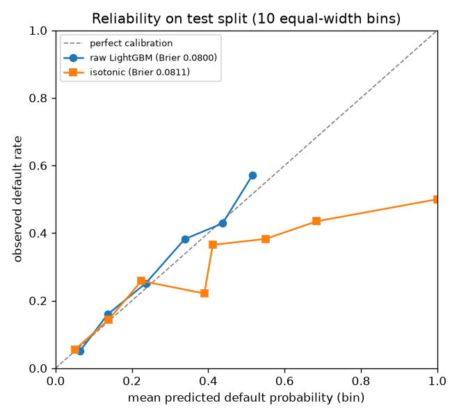
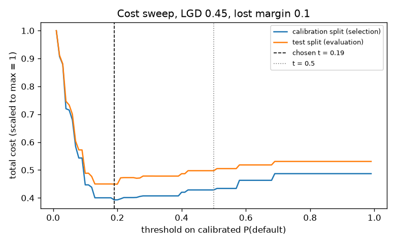
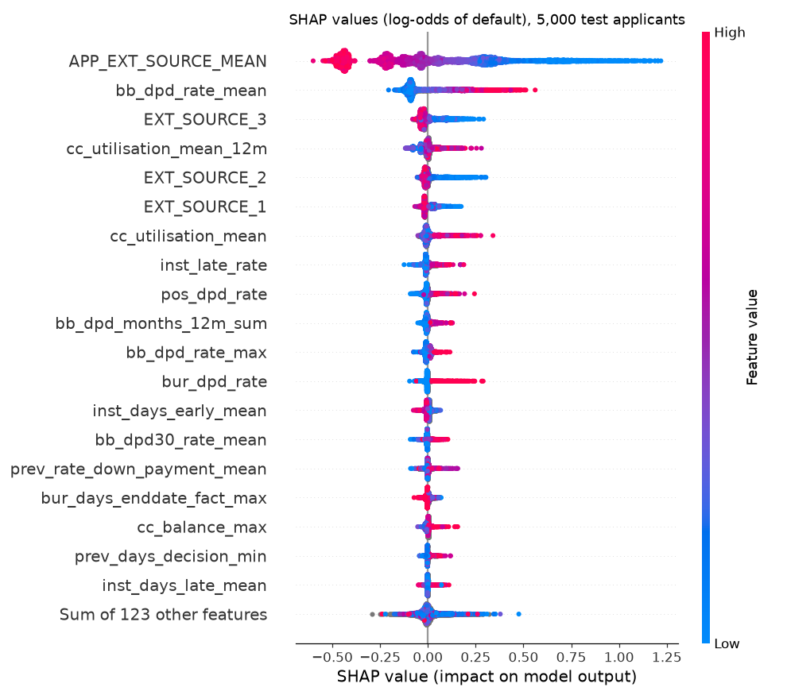
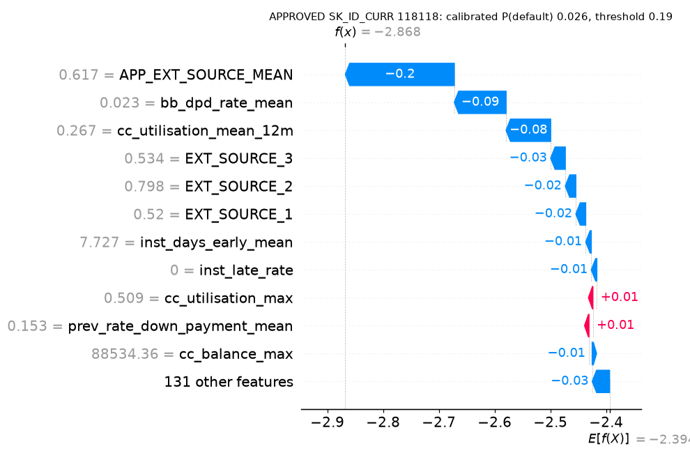
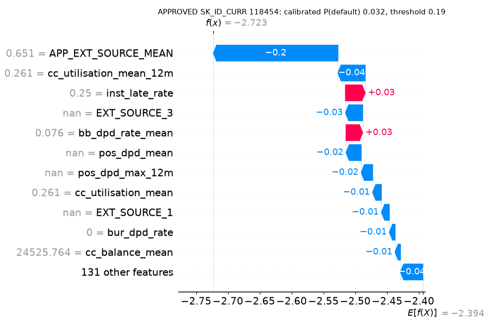
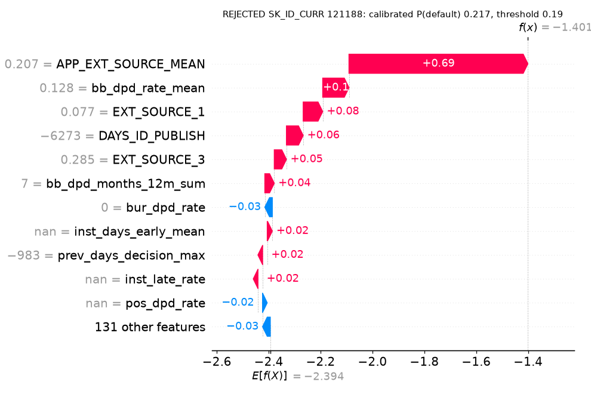
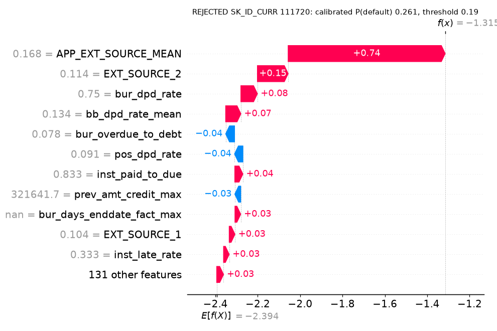

# Results

Generated by `python -m credit report` from the files in `results/`.

> **SYNTHETIC DATA.** These numbers come from generated test data, not from Home Credit. They only show that the code runs and say nothing about model quality.

### Data split (stratified on TARGET, seed 42)
| split | rows | default rate |
|---|---|---|
| calib | 3,001 | 0.0956 |
| test | 6,000 | 0.0957 |
| train | 20,999 | 0.0957 |

### Feature pipeline (DuckDB)
| table (SQL file) | features | rows out | seconds |
|---|---|---|---|
| application | 33 | 30,000 | 0.34 |
| bureau | 32 | 29,962 | 0.99 |
| previous_application | 27 | 28,912 | 0.28 |
| installments_payments | 19 | 24,880 | 0.64 |
| pos_cash_balance | 14 | 20,476 | 0.18 |
| credit_card_balance | 17 | 12,879 | 0.1 |

Total: **142 features** for **30,000 applicants** (one row per SK_ID_CURR), 19.5 s end to end (join + Parquet write 1.4 s), DuckDB 1.5.6, 8 threads.

Determinism: 2 runs, identical SHA-256 = **True** (`825d91a034b0418e...`).

### Models (test split, 6,000 rows)
| run | features | test ROC-AUC | test PR-AUC | test Brier | train s | trees |
|---|---|---|---|---|---|---|
| logreg_app | 33 | 0.7332 | 0.2366 | 0.2121 | 0.66 |  |
| lgbm_app | 33 | 0.7338 | 0.2294 | 0.0851 | 2.88 | 2 |
| lgbm_all | 142 | 0.7440 | 0.2467 | 0.0800 | 6.04 | 24 |
| lgbm_all_nosensitive | 139 | 0.7403 | 0.2399 | 0.0824 | 11.19 | 8 |

Fairness check: dropping CODE_GENDER, DAYS_BIRTH, APP_EMPLOYED_TO_AGE changes test AUC by **-0.0037** (0.7440 -> 0.7403).

### Table ablation (LightGBM, cumulative)
| step | added | n_features | best_iteration | test_auc | delta_vs_previous | delta_vs_app_only | train_seconds |
|---|---|---|---|---|---|---|---|
| 1 | app | 33 | 2 | 0.7338 |  | 0.0 | 2.88 |
| 2 | bureau | 65 | 20 | 0.73763 | 0.00383 | 0.00383 | 52.56 |
| 3 | previous_application | 92 | 5 | 0.73777 | 0.00014 | 0.00396 | 49.91 |
| 4 | installments | 111 | 7 | 0.7382 | 0.00043 | 0.0044 | 5.68 |
| 5 | pos_cc | 142 | 24 | 0.744 | 0.0058 | 0.0102 | 6.04 |

### Calibration (test split)
|  | Brier | ECE (10 bins) | ROC-AUC | mean predicted |
|---|---|---|---|---|
| raw LightGBM | 0.08002 | 0.01611 | 0.7440 | 0.0974 |
| isotonic (fit on calib split) | 0.08113 | 0.01425 | 0.7435 | 0.0974 |

Observed default rate on test: 0.0957. Brier change: +0.00111.

### Cost-based threshold (LGD 0.45, lost margin 0.1)
| policy | threshold | approval rate | default rate in approved | test cost |
|---|---|---|---|---|
| cost-optimal | 0.19 | 0.883 | 0.0702 | 128.9 M |
| 0.5 cut-off | 0.50 | 0.979 | 0.0889 | 142.6 M |
| approve all | none (approve all) | 1.000 | 0.0957 | 152.3 M |

Chosen on the calibration split, measured on the test split. The cost-optimal threshold cuts the test cost by **9.6%** vs the 0.5 cut-off and by **15.4%** vs approving everyone. Theory check: with perfectly calibrated probabilities the optimum is margin / (LGD + margin) = 0.182.

LGD sensitivity (threshold re-optimised on the calibration split for each LGD):
| LGD | chosen threshold | Bayes threshold | approval rate | cost optimal | cost @0.5 | cost approve-all | saving vs 0.5 | saving vs approve-all |
|---|---|---|---|---|---|---|---|---|
| 0.3 | 0.28 | 0.250 | 0.949 | 95.7 M | 96.6 M | 101.6 M | 0.9% | 5.8% |
| 0.45 | 0.19 | 0.182 | 0.883 | 128.9 M | 142.6 M | 152.3 M | 9.6% | 15.4% |
| 0.6 | 0.13 | 0.143 | 0.848 | 158.6 M | 188.7 M | 203.1 M | 15.9% | 21.9% |

### SHAP (TreeExplainer, 5,000 test rows)
| rank | feature | mean_abs_shap |
|---|---|---|
| 1 | APP_EXT_SOURCE_MEAN | 0.2893 |
| 2 | bb_dpd_rate_mean | 0.1161 |
| 3 | EXT_SOURCE_3 | 0.0420 |
| 4 | cc_utilisation_mean_12m | 0.0252 |
| 5 | EXT_SOURCE_2 | 0.0245 |
| 6 | EXT_SOURCE_1 | 0.0233 |
| 7 | cc_utilisation_mean | 0.0221 |
| 8 | inst_late_rate | 0.0172 |
| 9 | pos_dpd_rate | 0.0156 |
| 10 | bb_dpd_months_12m_sum | 0.0126 |

### Wall-clock time per stage (seconds)
| stage | seconds |
|---|---|
| features | 19.5 |
| features_rebuild_for_determinism | 18.41 |
| train_logreg_app | 93.81 |
| ablate | 260.13 |
| train_lgbm_all_nosensitive | 23.16 |
| calibrate | 0.76 |
| threshold | 0.86 |
| explain | 15.7 |

Hardware: AMD Ryzen 9 5900HX with Radeon Graphics, 16 logical cores, None GB RAM, Windows 10 (10.0.19045), Python 3.12.10. Libraries: duckdb 1.5.6, lightgbm 4.7.0, scikit-learn 1.9.1, shap 0.49.1, mlflow 3.17.1, pandas 3.0.6, numpy 1.26.4, pyarrow 25.0.1.
